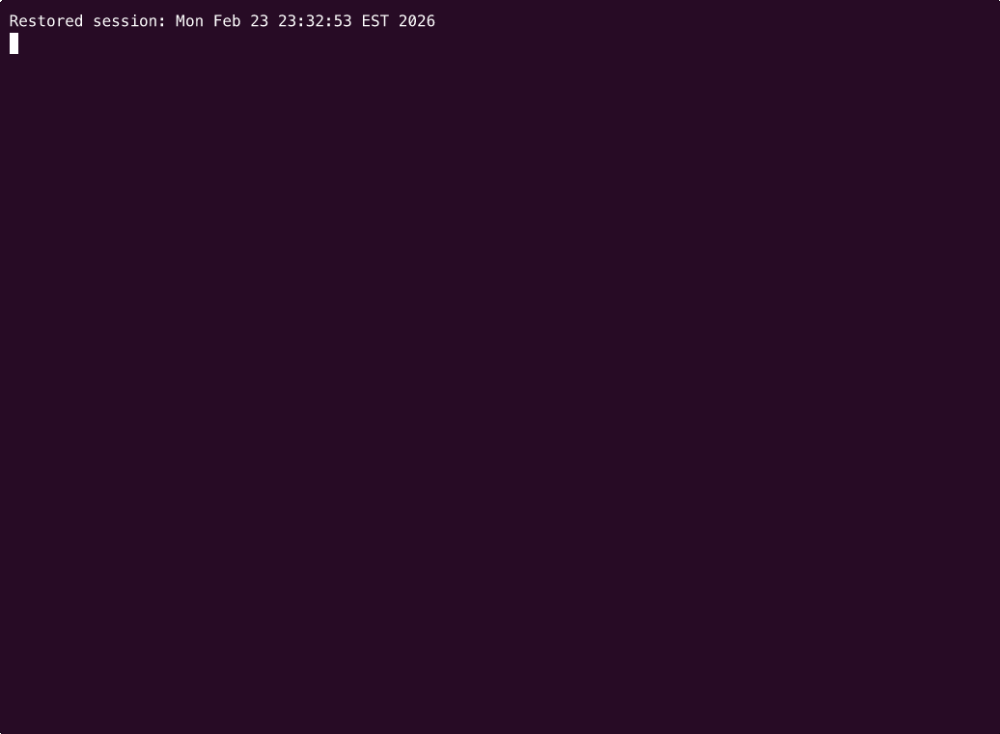
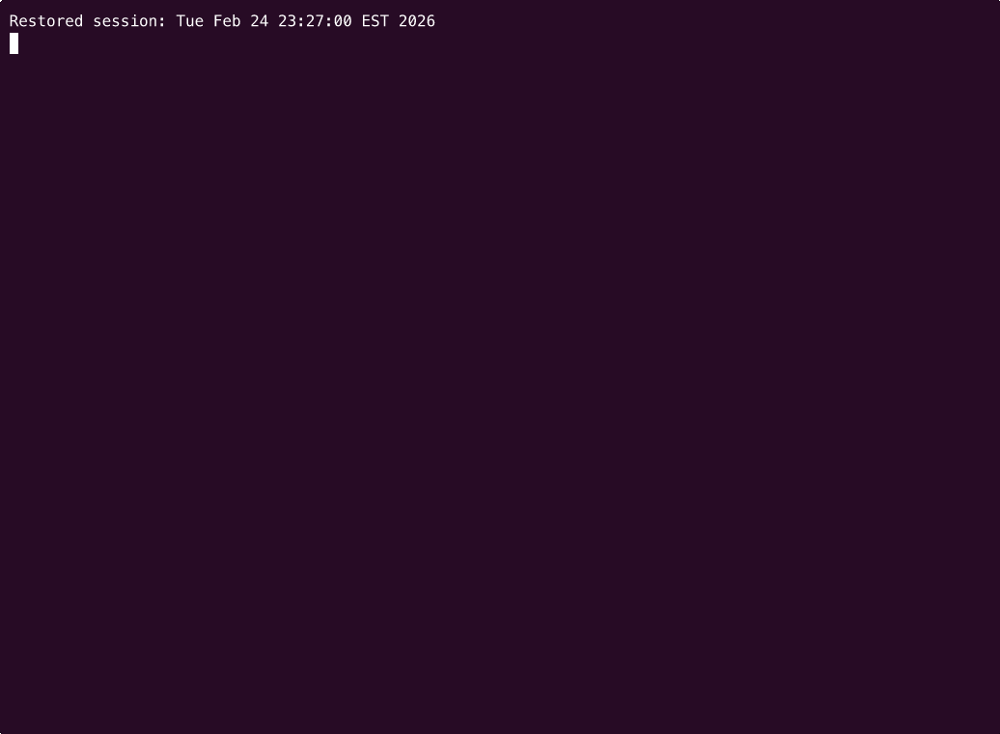
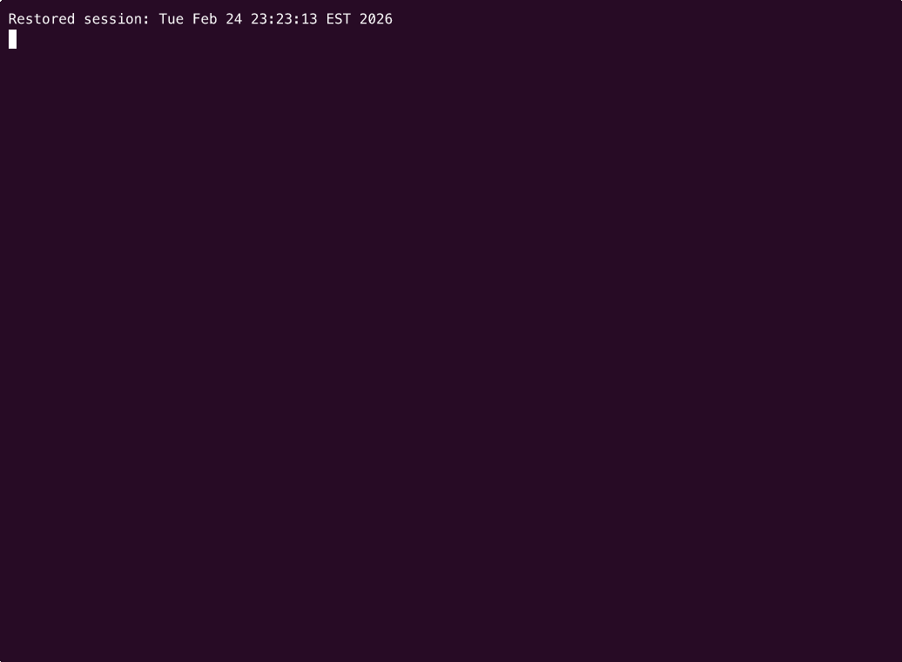
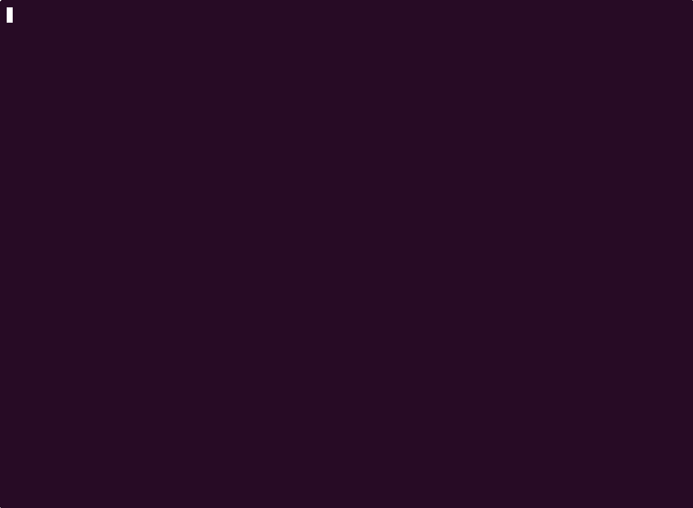

# Termflux

Animated backgrounds for your terminal. Termflux runs your shell inside a composited terminal, overlaying animated effects behind your shell output.

## Demo



## Quick Start

```sh
cargo install termflux && termflux
```

That's it — your terminal now has an animated background. You need [Rust](https://rustup.rs/) installed first.

## Built-in Animations

- **Starfield** - Parallax 3D star field with twinkling
- **Matrix** - Matrix-style rain with katakana characters
- **Fire** - Perlin noise-based fire simulation

## External Programs

Any terminal program can be used as an animation background. For example, [astroterm](https://github.com/da-luce/astroterm) renders a real-time star map.

If the external program is not installed, Termflux can auto-install it via a custom shell command.

## Installation

### Pre-built binaries

Download the latest binary for your platform from the [Releases](https://github.com/tndoan/termflux/releases) page. Binaries are available for macOS (Intel and Apple Silicon) and Linux (x86_64 and aarch64).

On macOS, you may need to remove the quarantine attribute before running:

```sh
xattr -d com.apple.quarantine termflux-aarch64-apple-darwin
```

### From source

```sh
git clone https://github.com/tndoan/termflux.git
cd termflux
cargo build --release
```

The binary will be at `target/release/termflux`.

## Usage

```sh
termflux
```

Termflux launches your default shell (`$SHELL`) with an animated background.

### Hotkeys

| Keys | Action |
|------|--------|
| `Alt + j` | Decrease opacity |
| `Alt + k` | Increase opacity |
| `Alt + a` | Toggle animation on/off |
| `Alt + n` | Cycle to next animation |

> **macOS**: Alt is the Option key (&#x2325;). You may need to enable "Use Option as Meta key" in your terminal emulator settings.

## Configuration

Termflux loads configuration from:

1. `config.toml` in the current directory
2. `~/.config/termflux/config.toml`

### Example config.toml

```toml
# Animation: "starfield", "matrix", "fire", "external", or "none"
animation = "starfield"

# Animation opacity (0.0 = invisible, 1.0 = full)
opacity = 0.8

# Frames per second
fps = 30

# Shell to launch (defaults to $SHELL)
# shell = "/bin/zsh"

# Background color in hex (auto-detected from terminal if omitted)
# background = "#0a0a23"

# Suppress animation when in alternate screen (vim, htop, etc.)
disable_animation_alt_screen = false
```

### Background color

By default, Termflux auto-detects your terminal's background color using the OSC 11 escape sequence. This works in most modern terminals (Terminal.app, iTerm2, Kitty, Ghostty, Alacritty, WezTerm, GNOME Terminal, Konsole, etc.) and ensures the animation background matches your terminal with no configuration needed.

If detection fails (e.g. Linux TTY, tmux without passthrough), it falls back to `#0a0a23`. You can also set an explicit value in your config:

```toml
background = "#1a1b26"
```

### External program animation

```toml
animation = "external"
external_command = "astroterm --color --constellations --speed 10000 --fps 64 --city Singapore"

# Auto-install if not found (runs via sh -c)
external_command_install = 'mkdir -p ~/.config/termflux/bin && curl -fsSL -o ~/.config/termflux/bin/astroterm https://github.com/da-luce/astroterm/releases/latest/download/astroterm-darwin-aarch64 && chmod +x ~/.config/termflux/bin/astroterm'
```

When `external_command_install` is set and the binary is not found in `PATH` or `~/.config/termflux/bin/`, Termflux runs the install command automatically on first launch.

You can also auto-build from a git repository:

```toml
animation = "external"
external_command = "myprogram"
external_command_repo = "https://github.com/user/myprogram.git"
```

This clones the repo, runs `make`, and copies the binary to `~/.config/termflux/bin/`.

## Example

Note: the `external_command_install` is for `macOS`. If you use other OS, please customize.

### Use `weathr` as background


Example `config.toml`

```
opacity = 0.3
fps = 30                                                                         
disable_animation_alt_screen = false   

animation = "external"
external_command = "weathr --hide-hud"
external_command_install = "mkdir -p ~/.config/termflux/bin && curl -fsSL -o ~/.config/termflux/bin/weathr https://github.com/Veirt/weathr/releases/latest/download/weathr-macos-arm64 && chmod +x ~/.config/termflux/bin/weathr"
```

### Use `astroterm` as background



Example `config.toml`

```
opacity = 0.3
fps = 30                                                                         
disable_animation_alt_screen = false   

animation = "external"
external_command = "astroterm --color --constellations --speed 10000 --fps 64 --city Singapore"
# Auto-install if not found (runs via sh -c)
external_command_install = 'mkdir -p ~/.config/termflux/bin && curl -fsSL -o ~/.config/termflux/bin/astroterm https://github.com/da-luce/astroterm/releases/latest/download/astroterm-darwin-aarch64 && chmod +x ~/.config/termflux/bin/astroterm'
```

### Use `top` as background (because why not?)



Example `config.toml`

```
opacity = 0.3
fps = 30                                                                         
disable_animation_alt_screen = false   

animation = "external"
external_command = "top"
```

### Use `Starfield` (built-in) 



Example `config.toml`

```
animation = "starfield"
opacity = 0.3
fps = 30                                                                         
disable_animation_alt_screen = false 
```

Replace `starfield` by `fire` or `matrix` if you want to use these built-in animation

## License

MIT
